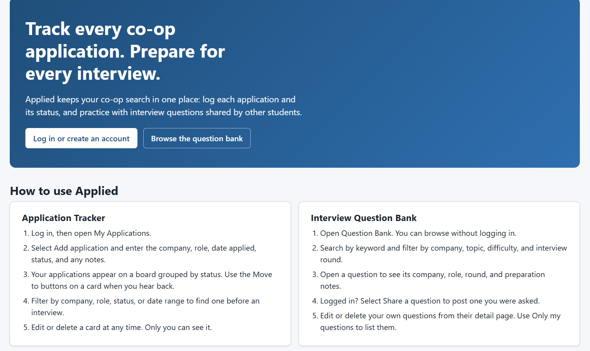
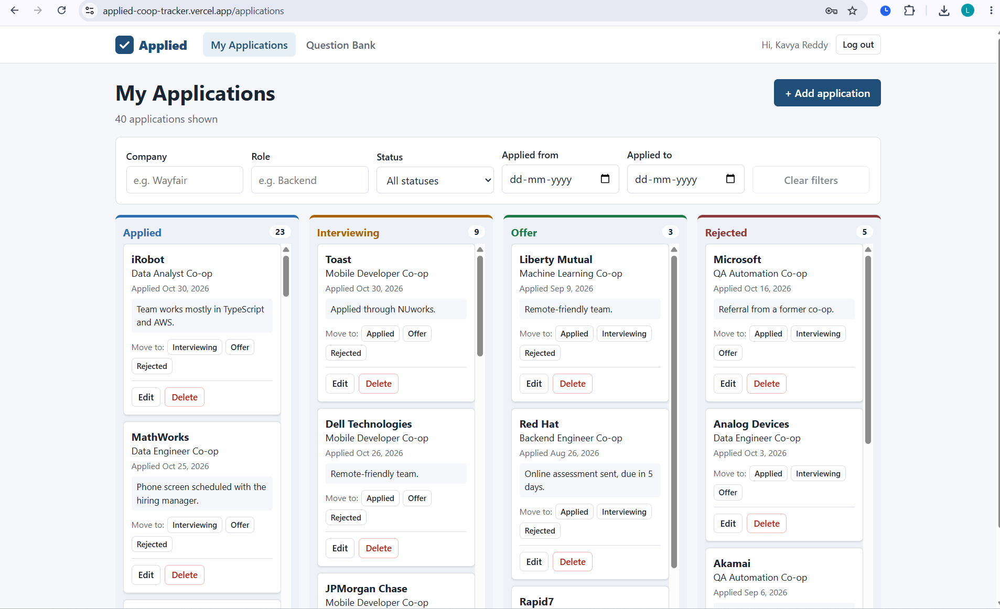
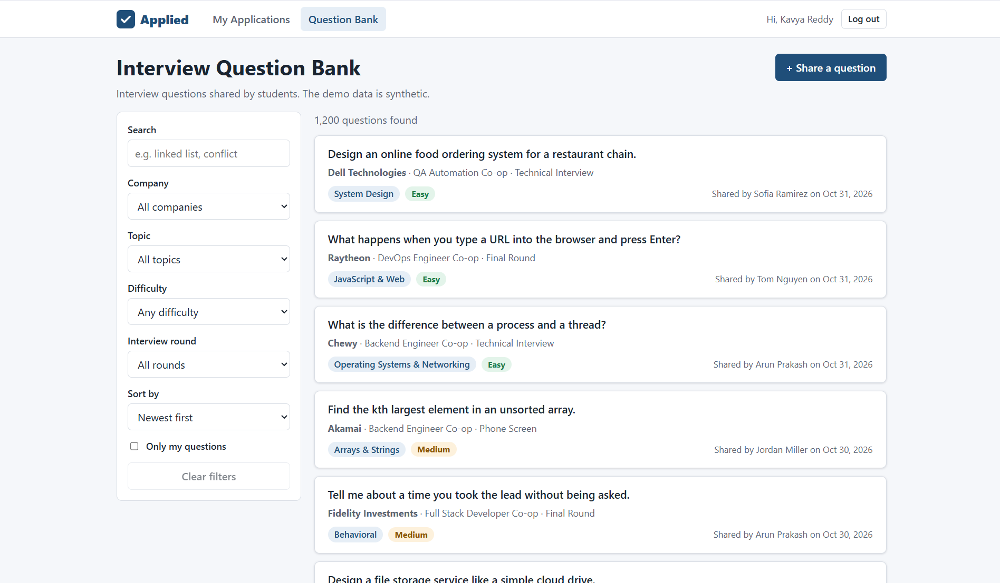
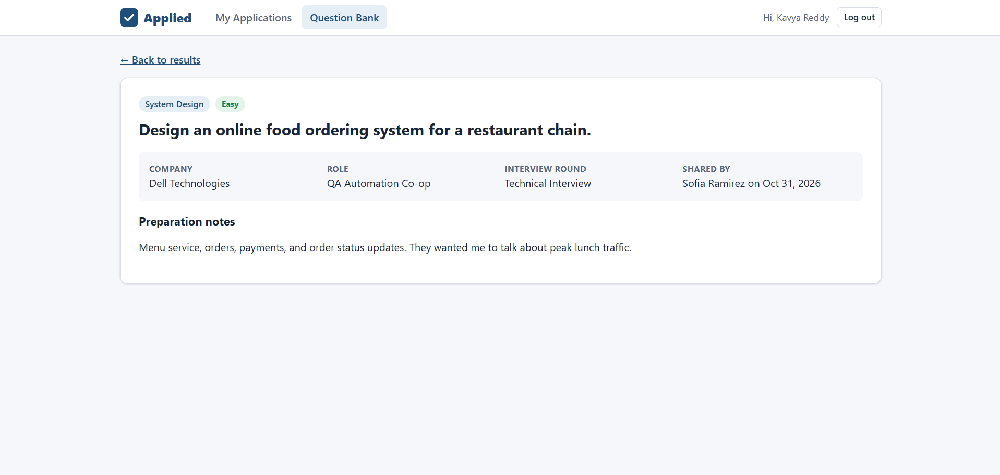

# Applied

**Track every co-op application and prepare with interview questions shared by students.**

- **Live app**: https://applied-coop-tracker.vercel.app
- **Demo video**: https://www.youtube.com/watch?v=6uTBFgl46nI
- **Slides**: https://docs.google.com/presentation/d/13ufjBw5ph3RnRZhfXCPjKZLmb631WQGIAWf5Za7HZmU/edit?usp=sharing

## Authors

- **Kothuri Venkata Srujan**: Application Tracker (users, Passport authentication, applications collection, status board)
- **Lakshmana Kontemukkula**: Interview Question Bank (questions collection, question seed, question search, detail, and form)

## Class

CS 5610 Web Development, Northeastern University, taught by John Alexis Guerra Gómez.
Class page: https://johnguerra.co/classes/webDevelopment_online_fall_2026/

## Project objective

Co-op search at Northeastern means applying to dozens of companies at once. Most students track applications in a spreadsheet or not at all, lose track of who replied, and find past interview questions scattered across group chats.

Applied has two independent features:

1. **Application Tracker** (login required): log every application (company, role, date applied, status, notes), see them on a board grouped by status (Applied, Interviewing, Offer, Rejected), move them between statuses with one click, and filter by company, role, status, or date range. Applications are private to each account.
2. **Interview Question Bank** (public to browse; sharing, editing, and deleting require an account): search interview questions by keyword, company, topic, difficulty, and interview round. Open a question to read its preparation notes, and share, edit, or delete questions you were asked yourself.

The full design document, with personas, user stories, and wireframes, is in [docs/DESIGN.md](docs/DESIGN.md).

## Screenshots

**Home page**: what Applied does, with step-by-step instructions for both features.



**Application Tracker**: applications grouped by status, with filters and one-click status changes.



**Interview Question Bank**: search and filter 1,200 interview questions.



**Question detail**: interview details and preparation notes.



## Tech stack

- **Frontend**: React 18 with hooks, React Router, the Fetch API, PropTypes, and Vite
- **Backend**: Node.js and Express 5
- **Database**: MongoDB through the official native driver (no Mongoose)
- **Authentication**: Passport (`passport-local`) with `express-session` and `bcryptjs`. Sessions are stored in MongoDB by a small custom store in `backend/db/sessionStore.js`.
- **Code quality**: ESLint (flat config) and Prettier in both packages

No CORS middleware is needed. In development, Vite proxies `/api` to Express, and in production `frontend/vercel.json` forwards `/api` to the deployed API, so the browser only talks to one origin.

All data in the deployed app is synthetic, generated by `npm run seed` (1,000+ records across users, questions, and applications).

## Project structure

```
backend/
  app.js        Express app (exported for Vercel)
  server.js     starts the app locally
  config/       environment loading and shared constants
  db/           MongoDB connection and one module per collection
  auth/         Passport strategy and session serialization
  middleware/   requireAuth
  routes/       API routes
  seed/         synthetic data generator (npm run seed)
  utils/        validation helpers
frontend/
  vercel.json       forwards /api to the API and sends page URLs to index.html
  src/api/          fetch wrapper for the API
  src/components/   one folder per component: Component.jsx + Component.css
  src/hooks/        useDebouncedValue
  src/utils/        PropTypes shapes and constants
  src/styles/       global design tokens
docs/           design document and wireframes
```

## Build and run locally

Requirements: Node.js 20.12 or newer, and a MongoDB database (a free MongoDB Atlas cluster works).

1. Install dependencies:

   ```bash
   cd backend && npm install
   cd ../frontend && npm install
   ```

2. Configure the backend by copying the example environment file and filling in your values:

   ```bash
   cp backend/.env.example backend/.env
   ```

   Set `MONGODB_URI`, `DB_NAME`, `SESSION_SECRET` (a long random string), and `DEMO_PASSWORD`. `.env` is git-ignored and must never be committed.

3. Seed the database with synthetic data. This replaces any existing data in the configured database.

   ```bash
   cd backend && npm run seed
   ```

   The demo accounts `kavya`, `daniel`, and `arun` (and seven more) use the `DEMO_PASSWORD` you set.

4. Start both servers in two terminals:

   ```bash
   cd backend && npm run dev
   ```

   ```bash
   cd frontend && npm run dev
   ```

   Then open http://localhost:5173.

## Deployment (Vercel)

The app is deployed as two Vercel projects from this repository:

| Project | Root Directory | Framework | URL |
|---|---|---|---|
| Frontend (the app users open) | `frontend` | Vite | https://applied-coop-tracker.vercel.app |
| API | `backend` | Express | https://applied-coop-tracker-api.vercel.app |

`frontend/vercel.json` forwards every `/api/...` request to the API project and sends page URLs such as `/applications` to `index.html`, so React Router can show the right page. Because the browser only ever talks to the frontend's domain, no CORS setup is needed and the login cookie works normally.

To deploy your own copy:

1. Create the API project with Root Directory `backend` and add the environment variables `MONGODB_URI`, `DB_NAME`, `SESSION_SECRET`, and `NODE_ENV=production`.
2. Create the frontend project with Root Directory `frontend`. It needs no environment variables. If your API URL differs, update the destination in `frontend/vercel.json`.
3. In MongoDB Atlas, allow access from `0.0.0.0/0`, because Vercel's IP addresses change.

### Lint and format

```bash
cd backend && npm run lint && npm run format:check
cd frontend && npm run lint && npm run format:check
```

## AI disclosure

We used Claude (Anthropic) throughout this project: to compare project ideas, generate the initial code for both features and the design document wireframes, review the code against the rubric, plan the commits, and debug setup and deployment problems. Each of us reviewed, tested, and committed our own feature, and we can explain every part of the code.

## License

[MIT](LICENSE)
