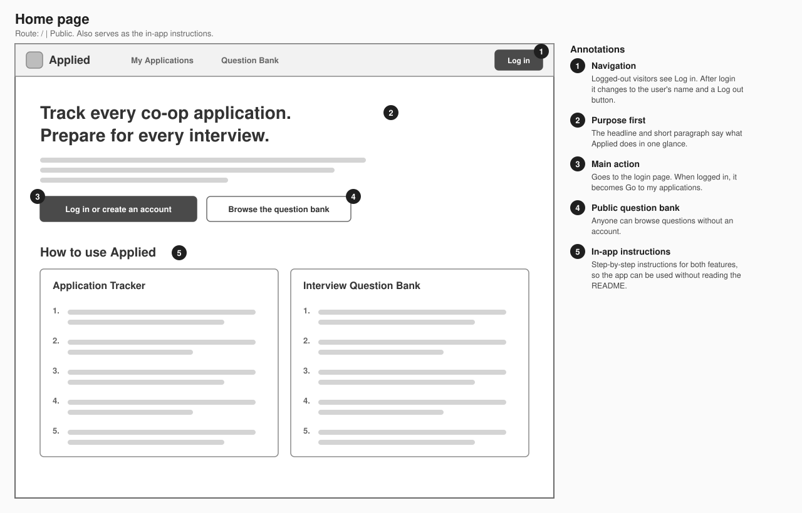
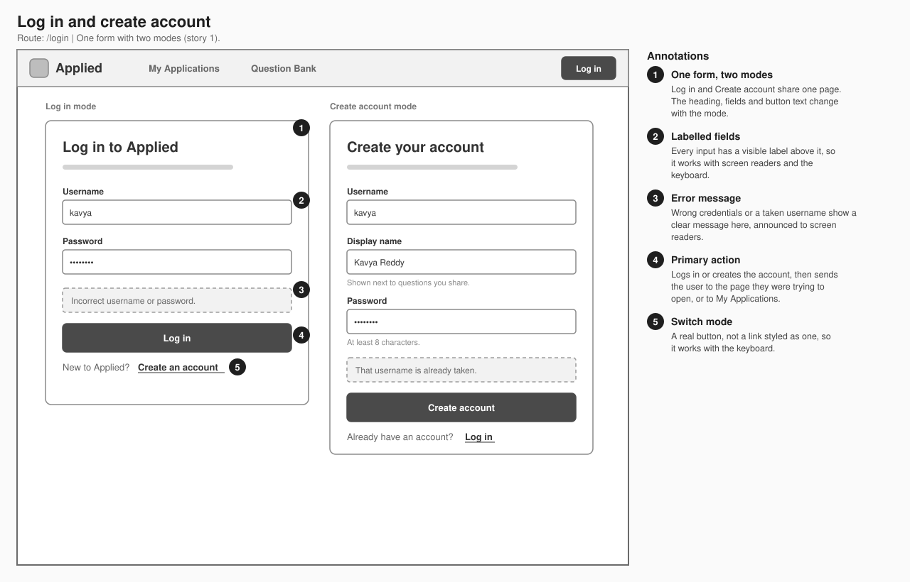
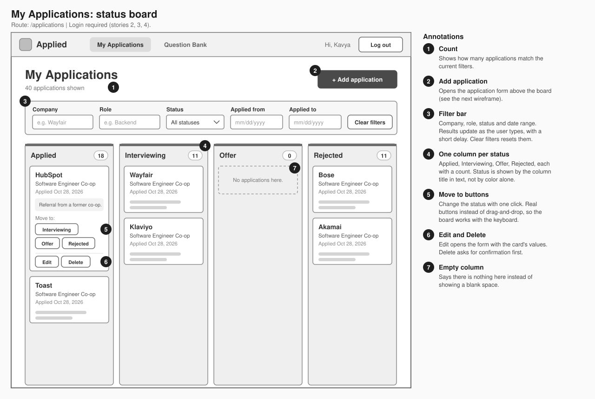
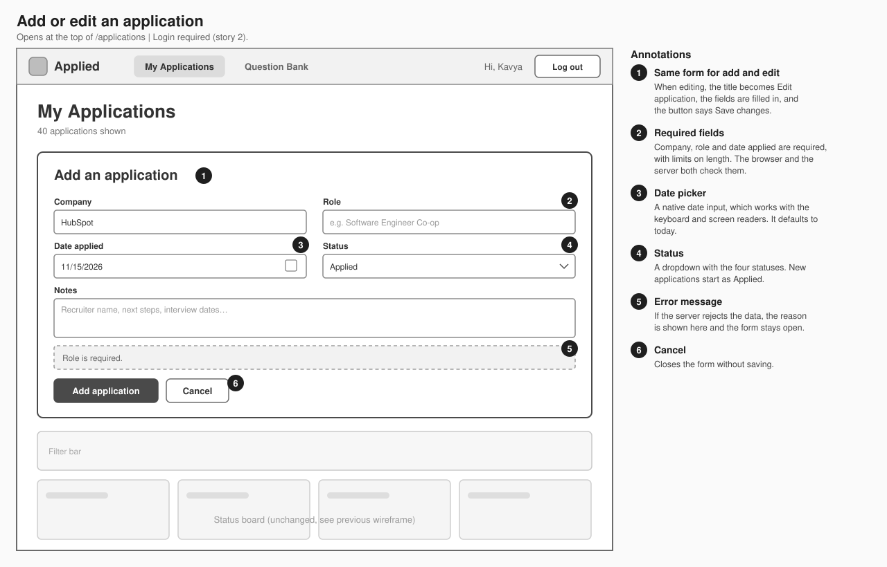

# Applied: Design Document

**Team**: Kothuri Venkata Srujan, Lakshmana Kontemukkula
**Course**: CS 5610 Web Development, Northeastern University

## 1. Project description

Co-op search at Northeastern means applying to dozens of companies at once. Most students track applications in a spreadsheet or not at all. They lose track of which companies replied and which interviews are coming up, and they forget what was asked in past rounds. Interview experiences get shared in scattered group chats and are hard to find again.

**Applied** is a client-side rendered web app (React with hooks, on a Node, Express, and MongoDB backend) with two independent features:

- **Application Tracker** (owner: Srujan). Students log each application with company, role, date applied, status, and notes. They see the applications on a board grouped by status (Applied, Interviewing, Offer, Rejected), change a status with one button, and search or filter by company, role, status, and date. Applications are private to each account.
- **Interview Question Bank** (owner: Lakshmana). Students search a shared bank of interview questions by keyword, company, topic, difficulty, and interview round. They open a question to read its preparation notes, and they share, edit, or delete questions they were asked.

Users log in with Passport, so applications stay private and every shared question shows who posted it. The database is seeded with 1,200 synthetic interview questions and about 350 synthetic applications for demo accounts.

The two features do not depend on each other. Each question stores its own company and role, so the question bank never reads the applications collection.

## 2. User personas

### Kavya, first-year MS student

- **Background**: First semester of an MS in Computer Science. She is looking for her first co-op and has sent applications to about 30 companies through NUworks, LinkedIn, and referrals.
- **Goals**: One place to see where every application stands, and to know which ones need a follow-up.
- **Frustrations**: Her spreadsheet is out of date. She has missed recruiter emails because she forgot she had applied to a company.
- **Tech comfort**: High. She expects a quick, clean interface that works on her laptop and phone.

### Daniel, career changer

- **Background**: He worked six years in mechanical engineering before joining the Align MSCS program. He has several technical interviews lined up.
- **Goals**: Practice with questions that companies actually ask, filtered to the company and round he is about to face.
- **Frustrations**: Generic question lists online don't tell him what a specific Boston company focuses on, and he doesn't know which topics to prioritize.
- **Tech comfort**: Medium. He needs clear labels and instructions.

### Arun, returning co-op student

- **Background**: Second-year student who just finished several interview rounds and accepted an offer.
- **Goals**: Share the questions he was asked, with tips, so other students can prepare. He also wants to fix or remove his posts later.
- **Frustrations**: Advice he posted in group chats disappears in the scroll, and he can't edit it.
- **Tech comfort**: High.

## 3. User stories

### Application Tracker (Srujan)

1. **Private account**: As Kavya, I want to register, log in, and log out, so my application list stays private.
   _Kavya creates an account on the login page with a username, display name, and password. When she logs out on the library computer, nobody else can see her list._
2. **Keep an accurate record**: As Kavya, I want to add, edit, and delete applications with company, role, date applied, status, and notes, so I keep an accurate record.
   _After the career fair, Kavya selects **Add application** for HubSpot and writes "Referral from a former co-op" in the notes. When the recruiter changes the role title, she edits the card. She deletes a duplicate she entered by mistake._
3. **See what needs attention**: As Kavya, I want to see my applications grouped by status and change a status with a button, so I know what needs attention.
   _Toast invites Kavya to a phone screen. On the Toast card in the Applied column she selects **Move to: Interviewing**, and the card moves columns. The column counts show her at a glance that 11 applications are in interviews._
4. **Find one fast**: As Daniel, I want to search and filter my applications by company, role, status, and date, so I can quickly find one before an interview.
   _Ten minutes before a call, Daniel types "Wayfair" in the company filter and sees his notes from when he applied._

### Interview Question Bank (Lakshmana)

5. **Targeted practice**: As Daniel, I want to search and filter questions by company, topic, difficulty, and interview round, so I can prepare for a specific interview.
   _Daniel has a Wayfair technical interview on Friday. He picks Company = Wayfair and Round = Technical Interview, then narrows to Difficulty = Medium. The URL keeps his filters, so he bookmarks the search._
6. **Understand what to expect**: As Daniel, I want to open a question and see its company, role, round, topic, difficulty, and preparation notes, so I understand what to expect.
   _Daniel opens "Design an LRU cache", reads that the interviewer wanted working code in 45 minutes, and practices it the same way. **Back to results** returns him to his filtered list._
7. **Share what I was asked**: As Arun, I want to add, edit, and delete questions I was asked, so other students can learn from my interviews.
   _After his final round, Arun selects **Share a question**, fills in the form, and posts it with his name. Later he spots a typo, opens the question, and selects **Edit question**. The Edit and Delete buttons only appear on his own questions, and the server rejects changes from anyone else._

## 4. Design mockups

Greyscale wireframes of every screen. The numbered markers on each screen point to the annotations beside it, which explain the purpose of each element and how it supports the user stories.

### Home page (instructions)



### Log in and create account (story 1)



### Application board (stories 3, 4)



### Add or edit an application (story 2)



## 5. Data model (MongoDB, native driver)

**users**

```
{ _id, username (unique, lowercase), displayName, passwordHash (bcrypt), createdAt }
```

**applications**: full CRUD, always filtered by the logged-in user's id

```
{ _id, userId, company, role, dateApplied ("YYYY-MM-DD"),
  status: "Applied" | "Interviewing" | "Offer" | "Rejected",
  notes, createdAt, updatedAt }
```

**questions**: full CRUD, and only the author may update or delete

```
{ _id, question, company, role,
  round: "Online Assessment" | "Phone Screen" | "Technical Interview" | "Behavioral Interview" | "Final Round",
  topic: one of 10 topics (Arrays & Strings, Trees & Graphs, System Design, Behavioral, ...),
  difficulty: "Easy" | "Medium" | "Hard",
  prepNotes, authorId, authorName, createdAt, updatedAt }
```

**sessions**: Passport login sessions with a TTL index on `expires`.

## 6. API

| Method | Path                           | Auth           | Description                                                                              |
| ------ | ------------------------------ | -------------- | ---------------------------------------------------------------------------------------- |
| POST   | `/api/auth/register`           | none           | Create an account and log in                                                             |
| POST   | `/api/auth/login`              | none           | Log in (Passport local strategy)                                                         |
| POST   | `/api/auth/logout`             | session        | Log out and destroy the session                                                          |
| GET    | `/api/auth/me`                 | none           | Current user, or `null`                                                                  |
| GET    | `/api/applications`            | login          | List own applications (`company`, `role`, `status`, `from`, `to`)                        |
| POST   | `/api/applications`            | login          | Create an application                                                                    |
| PUT    | `/api/applications/:id`        | login          | Update an application                                                                    |
| PATCH  | `/api/applications/:id/status` | login          | Change only the status                                                                   |
| DELETE | `/api/applications/:id`        | login          | Delete an application                                                                    |
| GET    | `/api/questions`               | none           | Search (`q`, `company`, `topic`, `difficulty`, `round`, `mine`, `sort`, `page`, `limit`) |
| GET    | `/api/questions/options`       | none           | Values for the filter dropdowns                                                          |
| GET    | `/api/questions/:id`           | none           | One question                                                                             |
| POST   | `/api/questions`               | login          | Share a question                                                                         |
| PUT    | `/api/questions/:id`           | login + author | Edit a question                                                                          |
| DELETE | `/api/questions/:id`           | login + author | Delete a question                                                                        |

## 7. React component structure

```
App (session check, routes)
├── NavBar
├── HomePage (instructions)
├── LoginPage (log in / register)
├── RequireAuth (route guard)
├── ApplicationsPage
│   ├── ApplicationForm
│   ├── ApplicationFilters
│   └── StatusBoard → StatusColumn → ApplicationCard
├── QuestionsPage
│   ├── QuestionFilters → ChoiceFilter
│   ├── QuestionList → QuestionCard → DifficultyBadge
│   └── Pagination
├── QuestionDetail → DifficultyBadge
├── QuestionForm
└── NotFound
```

Every component is a function component in its own folder and file. Components that need styling have a CSS file with the same name, imported in the component's file. The page and form components use hooks (`useState`, `useEffect`), and every component that receives props declares PropTypes.
